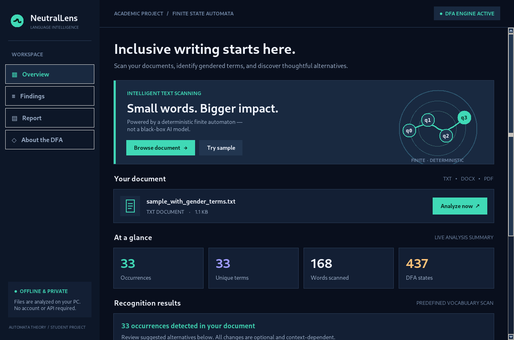

# NeutralLens — Gender-Neutral Language Recognizer

A modern, **offline Windows desktop** application for a Finite State Automata (FSA / DFA) machine problem. Written in Python with a custom dark Tkinter GUI.



## What it does

- Choose a `.txt`, `.docx`, or text-based `.pdf` file.
- Extract readable text, then recognize gender-specific words and phrases using a **deterministic finite automaton**, not a dictionary-membership `if` statement.
- Display original terms, suggested gender-neutral alternatives, occurrence counts and line numbers.
- Highlight detected terms in a document preview.
- Generate a detailed report and save it as `.txt` or export detections as `.csv`.
- Display the exact message **"No predefined gender-specific terms were detected."** when no terms in the vocabulary match.
- Test immediately using included gendered and gender-neutral sample text documents.

## Run on Windows (VS Code or Command Prompt)

1. Extract the ZIP.
2. Open the folder `NeutralLens_GenderNeutralRecognizer` in VS Code.
3. Choose **Terminal > New Terminal**.
4. Run:

```bat
python --version
python -m pip install -r requirements.txt
python main.py
```

If the `python` command is not found, install Python and make sure it is added to PATH. This application works with ordinary Python 3.10+ where Tkinter is included.

## How to use

1. Click **Browse document** and choose `.txt`, `.docx`, or `.pdf`.
2. Click **Analyze now** to scan the file.
3. Review counts on the **Overview** page.
4. Select **Findings** to see detailed suggestions and highlighted text.
5. Select **Report** to export a TXT report, CSV file, or copy the report.
6. Open **About the DFA** for a visual explanation of how automata recognize words.

**Quick demo:** Click **Try sample** on Overview and the app will automatically load and analyze `samples/sample_with_gender_terms.txt`. For a zero-match demo, browse `samples/sample_gender_neutral.txt`. A longer test file is also included at `samples/expanded_sample.txt`.

## Files and responsibilities

| File | Role |
|---|---|
| `main.py` | Starts desktop app |
| `ui.py` | Modern dark GUI, navigation, document preview, save actions |
| `dfa_engine.py` | Builds and runs deterministic finite-state machine |
| `terms.py` | Predefined gender-specific terms and suggested alternatives |
| `document_reader.py` | Text extraction from TXT/DOCX/PDF |
| `reporting.py` | Generates counts and text/CSV reports |
| `tests/test_recognizer.py` | Automated validation tests |
| `samples/` | Example text files |

## How the DFA works (important for your presentation)

The automaton is built as a trie-like deterministic finite-state machine, using **characters as its input alphabet**. Every vocabulary term is inserted into a series of state transitions.

Example for `he`:

```text
q0 --h--> q1 --e--> q2*
                      * accepting
```

- `q0` is the initial state.
- Transitions move from state to state when a character is read.
- If a transition doesn't exist, the input reaches an implicit rejecting sink.
- Only a final accepting state is considered a complete match.
- The scanner checks whole words and phrases; `he` inside `the` does **not** count.
- For multi-word phrases, spaces become DFA transition characters after tokenization.

The `TermDFA.recognize()` method in `dfa_engine.py` follows each input character along state transitions. It **does not** use direct `if word in GENDER_TERMS` checks to decide whether a term is valid.

## Basic system flow

```text
OPEN APPLICATION
     ↓
INITIALIZE DFA FROM VOCABULARY
     ↓
CHOOSE A DOCUMENT
     ↓
EXTRACT TEXT (.txt / .docx / .pdf)
     ↓
TOKENIZE WORDS / BUILD PHRASE CANDIDATES
     ↓
RUN EACH CANDIDATE THROUGH DFA
     ↓
ACCEPTING STATE? ── NO ──→ CHECK NEXT CANDIDATE
     │ YES
     ↓
RECORD TERM / SUGGESTION / LINE NUMBER
     ↓
SHOW FINDINGS AND GENERATE REPORT
```

## Testing

From the project folder:

```bat
python -m unittest discover -s tests -v
```

## Limitations (be ready to explain these)

- The scanner identifies only words/phrases present in its predefined vocabulary. It is not a full natural-language model or comprehensive grammar checker.
- The tool **suggests** neutral language; it does not modify the original document.
- Gendered terms and pronouns are not inherently wrong in every context. Human review is important to maintain meaning and grammar.
- Text embedded as an image in scanned PDFs cannot be extracted without OCR, which is not part of this version.
- Legacy `.doc` files are not included because the functional requirements specify `.txt`, `.docx`, and `.pdf`.
- Document text is processed locally; no cloud APIs are required.

## Troubleshooting

**`No module named 'docx'` or `No module named 'pypdf'`:**

```bat
python -m pip install -r requirements.txt
```

**`python is not recognized`:** Reopen VS Code after Python installation and check PATH.

**`_tkinter` missing:** Install a regular Python distribution with the Tcl/Tk optional feature enabled.

**A scanned PDF reports no readable text:** Open a digitally created PDF or TXT/DOCX file instead; OCR is not part of this release.

## BISU instructor's October 24, 2026 project guide

The application now displays the exact no-match message: **"No predefined gender-specific terms were detected."**

The folder includes `PROJECT_DOCUMENTATION.docx` (completed template with cover, screenshots, FSA transition example, and verified tests), `TEST_RESULTS.txt`, and `SUBMISSION_CHECKLIST.md`.

The five assigned test fixtures are in `samples/` named `test_01` through `test_05`. All 11 included automated tests passed in the development environment. Run them yourself before submitting.

**Final student steps:** add a public GitHub link in the documentation and fill in the actual contributions of the four group members. Those details were not available and have not been invented.
